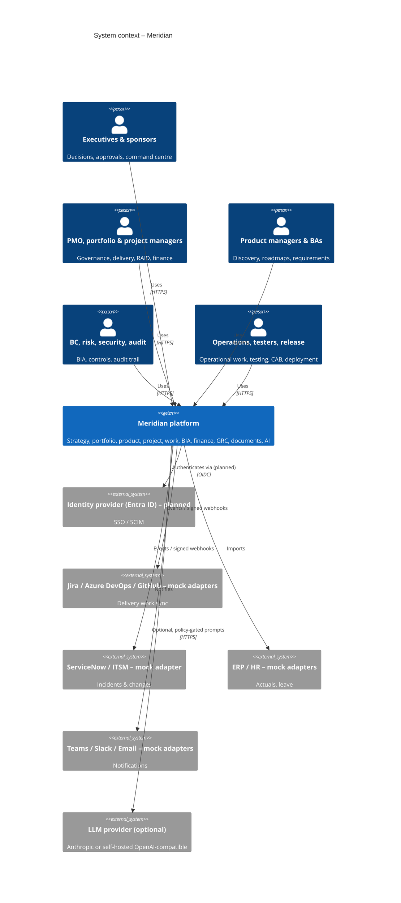
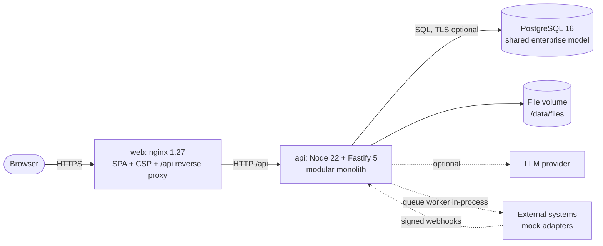
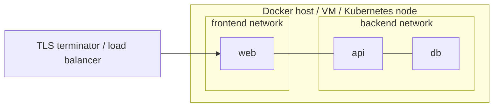
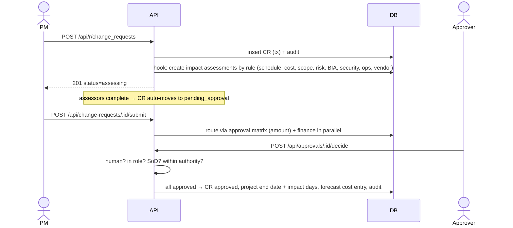

# Architecture

Meridian is a **modular monolith**: one deployable API with clear domain modules over one relational database, plus a static single-page web client. It is API-first, container-packaged and designed to split later only where scale or ownership demands (ADR-0001).

## 1. System context (C4 level 1)



## 2. Containers (C4 level 2)



| Container | Technology | Responsibility |
|---|---|---|
| web | React 18 + Vite build, served by nginx | UI, design system, charts; security headers; SPA routing; proxies `/api` |
| api | TypeScript, Fastify 5, pg, zod | Auth, RBAC/ABAC, validation, domain services, workflow/approvals, reporting, AI layer, integrations, jobs |
| db | PostgreSQL 16 | Single relational model (≈60 tables), constraints, audit immutability trigger |
| files | Docker volume | Attachments (scanning pipeline planned) |

## 3. API components (C4 level 3)

```mermaid
flowchart TB
  subgraph http[HTTP layer – app.ts]
    auth[auth: login, JWT, lockout, CSRF]
    routes[routes: /api/r/*, domain endpoints]
  end
  subgraph core[core]
    ctx[context & can()] --- audit[audit hash chain] --- codes[record codes] --- notify[notifications]
  end
  subgraph res[resources]
    registry[registry: field metadata] --> crud[generic CRUD: validate, refs, ABAC, hooks, audit]
  end
  subgraph domain[domain services]
    calc[calc: EVM, NPV/IRR, RICE, MTPD, RAG, load]
    wf[workflow & approvals]
    bia[BIA & traceability]
    fin[finance roll-up & FX]
    resm[capacity]
    rel[release readiness]
    dash[dashboards]
    docs[document generators]
    search[search]
    hooks[entity hooks: CR impact assessments, risk acceptance guard, defects from failures]
  end
  subgraph ai[ai]
    prov[providers: local / anthropic / openai-compatible] --- asst[assistant: retrieval, citations, injection checks, logging]
  end
  integ[integrations: queue, retry, dead-letter, webhooks, mock connectors]
  jobs[jobs: daily checks, queue processor]
  routes --> crud & wf & bia & fin & resm & rel & dash & docs & search & asst & integ
  crud --> hooks --> calc
  wf --> audit
  jobs --> integ & notify
```

Module boundaries are folders with one-way dependencies (`resources` → `domain/hooks` → `domain/*` → `core`). Cross-module calls go through service functions, never through another module's tables directly, except read-only reporting queries (documented in the dashboard module).

## 4. Deployment



- `docker compose up` runs db, api, web with health checks and restart policies; only the web port is published.
- Secrets come from `.env` (generated with random values by `start.sh`), never from the image.
- Production: put TLS in front (set `COOKIE_SECURE=true`), managed PostgreSQL with PITR, image scanning, and a separate worker container for jobs when running >1 API replica (ADR-0004).

## 5. Key flows

**Governed change request**


**AI question**: authenticate → `ai:use` check → injection scan → permission-trimmed search → per-record `getRow` (ABAC) → local summary *or* provider call with only public/internal records inside delimited `<record>` blocks → citations/confidence → `ai_interactions` + audit.

## 6. Data flow & classification
Data classes: public, internal, confidential, restricted (column on every business table). Restricted rows are filtered in SQL for non-owners; confidential/restricted are excluded from external AI providers. Audit events redact secret-like fields. See `docs/database/DATA_MODEL.md` and `docs/security/SECURITY.md`.

## 7. Integration architecture
Outbound: domain/test events → `integration_events` (idempotency key) → in-process processor (every 30s) → connector → delivered / failed (exponential backoff) / dead-letter (after max attempts) → manual retry. Inbound: `POST /api/hooks/:org/:key` → HMAC verification (live) or explicit mock header → de-duplication → field mapping → upsert work item → audit as `integration` actor. Secrets are referenced by name (`secret_ref`) and resolved from the environment.

## 8. Technology decisions
See `docs/decisions/` (ADR-0001…ADR-0009) – including the evaluated Angular + Laravel alternative.
