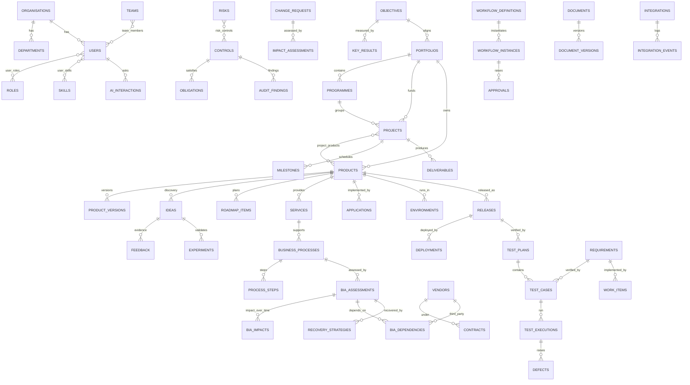
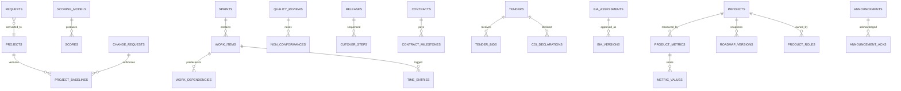

# Shared enterprise data model

Source of truth: `backend/migrations/001_core.sql`. One PostgreSQL schema; no per-module databases.

## Conventions
| Concern | Rule |
|---|---|
| Primary key | `id uuid DEFAULT gen_random_uuid()` |
| Human ID | `code` e.g. `PRJ-0007`, unique per organisation and prefix (`code_counters`) |
| Tenant boundary | `org_id` on every business table; every query filters by it |
| Ownership & status | `owner_id`, `status` on every business table |
| Audit fields | `created_at/by`, `updated_at/by`; `row_version` incremented by trigger (optimistic locking) |
| Soft delete | `deleted_at`; all reads exclude deleted rows; deletes are audited |
| Classification | `classification` public/internal/confidential/restricted (ABAC) |
| History | `audit_events` stores before/after per change (append-only, hash-chained); `document_versions`; `workflow_instances.history` |
| Polymorphic parent | `(context_type, context_id)` only where a record legitimately belongs to several parent kinds (work, RAID, finance, documents, tests). Validated in the service layer against the allowed list per resource |
| Many-to-many | explicit join tables (`project_products`, `team_members`, `user_skills`, `risk_controls`, `user_roles`) |
| Money | `numeric(16,2)` + `currency char(3)`; FX in `fx_rates`; reports convert to `organisations.base_currency` |
| Indexes | FKs used in filters, `(context_type, context_id)`, pending approvals, audit entity/time |
| Retention | Audit: retain ≥7 years (configurable, legal to confirm). AI interactions: 24 months. Soft-deleted records: purge job after retention (planned). Synthetic demo org flagged `is_synthetic` |

## ERD (core)

Polymorphic (`context_type/context_id`) entities: work_items, risks, issues, assumptions, budgets, cost_entries, benefits, business_cases, requirements, change_requests, resource_allocations, test_plans, defects, purchase_requests, contracts, documents, decisions, meetings, audit_findings, architecture_decisions. `dependencies` uses `(from_type, from_id) → (to_type, to_id)`.

## Entity catalogue (mapping to requested entities)
Organisation=`organisations`; Department=`departments`; User=`users`; Role/Permission=`roles.permissions`; Team=`teams`; Skill=`skills`; Portfolio; Programme; Project; Product; ProductVersion; Service; BusinessProcess (+`process_steps` = ProcessFlow); BusinessCapability; Idea; Opportunity = `ideas` at stage *assessing/discovery* (+`experiments`); Objective; KeyResult; RoadmapItem; Requirement; BacklogItem/WorkItem/Task = `work_items` (work_type); Milestone; Deliverable; ResourceAllocation; Budget; Cost=`cost_entries`; Benefit; Risk; Issue; Assumption; Dependency; ChangeRequest; BIA=`bia_assessments`; BIAImpact=`bia_impacts`; RecoveryStrategy; Vendor; Contract; PurchaseRequest; Invoice; TestPlan; TestCase; TestExecution; Defect; Release; Deployment; Approval; Decision; Document; DocumentVersion; SOP = `documents.doc_type='sop'`; Meeting; ActionItem = `work_items.work_type='action'`; AuditEvent; Notification; Integration (+events); AIInteraction. Additional: applications, environments, architecture_decisions, controls, obligations, audit_findings, impact_assessments, availability, fx_rates, approval_matrix, rag_thresholds, metric_definitions, files, job_runs.

## Constraints worth knowing
- `projects.end_date >= start_date`; allocations `0 < pct ≤ 100`; likelihood/impact 1..5; BIA severity 0..5; confidence 0..1; effort > 0.
- `bia_assessments` must reference a process, service or product.
- One active workflow instance per record (partial unique index).
- `invoices (vendor_id, invoice_number)` unique; `impact_assessments (change_request_id, area)` unique.
- `audit_events` UPDATE/DELETE blocked by trigger.

## Migration 002 – extended capabilities
`investment_scenarios`, `scenario_items`, `stakeholders`, `bc_exercises`, `skill_requirements`, `tenders`, `tender_bids`, `vendor_reviews`, `policies`, `policy_attestations` (immutable), `saved_views`, `requirement_versions` (immutable), `export_snapshots`, `ai_intakes`, `oidc_login_states`; columns `requirements.version/origin`, `users.oidc_subject`, `files.scan_*`, generated `document_versions.tsv` (GIN), `work_items.recurrence_parent_id/sla_breached`.

## Migration 003 – FRS v1.1 gaps
Standard business tables (org_id, code, status, owner, classification, audit fields, row_version, deleted_at): `requests`, `scoring_models`, `sprints`, `time_entries`, `raci_assignments`, `communications`, `announcements`, `quality_reviews`, `non_conformances`, `configuration_items`, `ocm_impacts`, `readiness_assessments`, `training_activities`, `contract_milestones`, `cutover_steps`, `tech_debt_items`, `lessons`, `product_roles`, `personas`, `hypotheses`, `launch_plans`, `product_metrics`, `pricing_plans`.

History/link tables: `scores`, `project_baselines`, `bia_versions`, `roadmap_versions` (all **immutable** via `history_immutable()` trigger), `work_dependencies` (FS/SS/FF/SF, lag, no self-links), `holidays`, `comments`, `watchers`, `announcement_acks`, `document_acks`, `finance_periods`, `coi_declarations` (unique per tender+user), `metric_values` (unique per metric+period+segment).

Key constraints: `cost_entries.entry_kind` adds `accrual`; reversals reference `reversal_of`; `scores` require `override_reason` when overridden; `time_entries.hours` 0 < h ≤ 24; readiness dimensions 1..5; `finance_periods` keyed by org + `YYYY-MM`.
